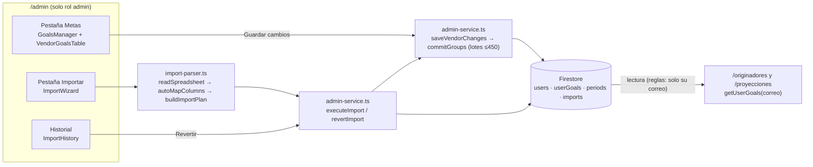

# Carga de metas: guía técnica

Este documento explica de punta a punta cómo una meta mensual llega desde el administrador hasta la pantalla del vendedor. Es la parte del sistema con más reglas y con más historia, así que conviene leerlo antes de tocar `src/lib/admin-service.ts` o cualquier archivo de `src/components/admin/`.

## Resumen

- **Una meta = un documento** en `userGoals` por cada par *(correo, periodo `YYYY-MM`)*.
- **La llave de todo es el correo en minúsculas** (`normalizeEmail`). Es el ID del perfil (`users/{correo}`) y el campo `userEmail` de cada meta. No se usa el `uid` de Firebase para relacionar datos.
- El admin escribe metas de **dos formas**, y ambas terminan en la misma función, `saveVendorChanges()` de `src/lib/admin-service.ts`:
  1. **Tabla**: *Admin → Metas* (`GoalsManager`). Edición en línea y acciones masivas.
  2. **Archivo**: *Admin → Importar* (`ImportWizard`), con CSV o XLSX, vista previa y opción de revertir.
- El vendedor **solo lee**: `getUserGoals(correo)` trae todas sus metas y la pantalla se queda con la del mes actual.
- Un periodo **cerrado** (`periods/{YYYY-MM}.locked = true`) bloquea, desde las reglas de Firestore, cualquier escritura de metas de ese mes.



## Modelo de datos en Firestore

### `users/{correo}`: perfil del vendedor o admin

| Campo | Tipo | Notas |
|---|---|---|
| `email` | string | Igual al ID del documento, en minúsculas. |
| `role` | `'admin' \| 'vendedor'` | Solo se cambia desde la consola de Firebase u otro admin. |
| `name` | string | Viene del archivo de importación o de Google al iniciar sesión. |
| `category` | `'G1'…'G4'` | Categoría vigente (ver tabla de categorías abajo). |
| `product` | `ProductType` | Producto vigente. |
| `region`, `manager` | string | Solo para filtrar en el admin. `manager` se guarda en minúsculas si es un correo. |
| `status` | `'activo' \| 'baja'` | Se escribe `'activo'` al crear. **No hay UI para dar de baja** (ver pendientes). |
| `uid` | string | Se llena la primera vez que la persona inicia sesión con Google. |
| `createdAt`, `updatedAt`, `lastLoginAt` | ISO string | `lastLoginAt` se refresca como máximo cada 12 h. |

### `userGoals/{goalDocId}`: meta de un vendedor en un periodo

| Campo | Tipo | Notas |
|---|---|---|
| `userEmail` | string | Correo en minúsculas. Es lo que filtran las reglas y `getUserGoals`. |
| `period` | `YYYY-MM` | |
| `monthlyGoal` | number | Meta de colocación en MXN (entero). |
| `category` | `'G1'…'G4'` | **Foto** de la categoría en ese periodo. Obligatoria. |
| `product` | `ProductType` | Foto del producto en ese periodo (opcional). |
| `updatedAt`, `updatedBy` | string | Fecha ISO y correo del admin que escribió. |
| `migratedAt` | string | Solo en metas movidas por la consolidación de datos anteriores. |

El ID del documento sale de `goalDocId(correo, periodo)` en `src/lib/admin-utils.ts`:

```
juan.perez@avivacredito.com + 2026-10  →  juan_perez_at_avivacredito_com-2026-10
```

Este formato es histórico y se mantiene para no duplicar documentos ya existentes. **No lo cambies** sin una migración.

> **Por qué la meta guarda categoría y producto.** La meta funciona como una foto del periodo. Si un vendedor sube de categoría en noviembre, su meta de octubre conserva la categoría de octubre. La calculadora usa `goal.category` por encima de la del perfil.

### `periods/{YYYY-MM}`: cierre de periodo

`{ locked: boolean, lockedAt, lockedBy, reopenedAt, reopenedBy }`. Si `locked == true`, las reglas rechazan crear, editar o borrar metas de ese periodo, y eso incluye importar y revertir.

### `imports/{autoId}` y `imports/{id}/chunks/{0000…}`: historial de importaciones

- Documento principal: `fileName`, `period`, `createdAt`, `createdBy`, `status` (`running | completed | partial | failed | reverted`), `totalRows`, `counts {new, update, unchanged, error}`, `applied`, `failed`, `finishedAt`, `revertedAt`, `revertedBy`, `revertKept` y `tracksAfter`.
- Subcolección `chunks`: cada documento guarda `entries`, con hasta 300 `RevertEntry`. Cada entrada tiene el "antes" (`profileBefore`, `goalBefore`) y el "después" (`profileAfter`, `goalAfter`) de un vendedor que tocó la importación. Con eso se revierte.
- `tracksAfter: true` indica que la importación guardó el "después". Las importaciones hechas antes de este cambio no lo tienen (ver [Revertir](#revertir)).

### `config/incentives`: esquema de incentivos

`goalAchievementLevels`, `qualityMultipliers`, `growthMultipliers`, `renewalMultipliers`, `updatedAt`, `updatedBy`. Se edita en *Admin → Esquema de incentivos*. Si el documento no existe, se usan los valores por defecto de `src/lib/incentives-config.ts`.

### Catálogos (`src/lib/types.ts`)

| Código | Etiqueta visible | Nota |
|---|---|---|
| `G1` | Formación | |
| `G2` | Territorio | |
| `G3` | Consolidado | |
| `G4` | Élite | |
| `G0` | G0 | Ya no se puede seleccionar; se conserva por datos antiguos y por las llaves de `bonusPercentages`. |

Productos: `aviva_contigo`, `aviva_tu_negocio` y `aviva_tu_compra` usan la tabla de **Renovaciones** (`RENEWAL_RATE_PRODUCTS`). `casa_marchand` y `construrama` usan la de **Crecimiento**.

## Vía 1: tabla de metas (Admin → Metas)

| Archivo | Responsabilidad |
|---|---|
| `src/app/(app)/admin/page.tsx` | Pestañas. Comparte el periodo entre Metas e Importar. Avisa antes de salir si hay cambios sin guardar. |
| `src/components/admin/GoalsManager.tsx` | **Cerebro de la pestaña**: carga, filtros, cambios pendientes, guardado, exportación y cierre de periodo. |
| `src/components/admin/VendorGoalsTable.tsx` | Tabla virtualizada (`@tanstack/react-virtual`) con edición en línea. Enter baja a la siguiente fila. |
| `src/components/admin/BulkActionsBar.tsx` | Acciones sobre los seleccionados: fijar meta, ajustar ±%, categoría, producto, quitar meta. |
| `src/components/admin/PeriodPicker.tsx` | Selector de mes. |
| `src/components/admin/LegacyDataBanner.tsx` | Aviso para consolidar datos de formato anterior (ver más abajo). |

**Carga.** `loadVendors()` lee **toda** la colección `users`, agrupa por correo y fusiona duplicados (`profile-merge.ts`). Luego `loadGoalsForPeriod()` trae las metas del periodo y las del anterior, que se muestran como referencia, y `getPeriodLock()` dice si el mes está cerrado. Los admins no aparecen en la lista.

**Edición.** Nada se escribe al editar. Cada cambio vive en el estado `pending` (`{ [correo]: { goal?, category?, product? } }`). Si un valor regresa a lo guardado, se descarta del pendiente. Una meta sin categoría queda marcada como inválida y no se guarda.

**Guardado.** `handleSave()` convierte los pendientes en `VendorChange[]` y llama a `saveVendorChanges(changes, period, actor)`:

1. `opsForChange()` arma, por vendedor, un `set` (con merge) del perfil si cambió categoría o producto y un `set` o `delete` de la meta.
2. `commitGroups()` agrupa las operaciones en lotes de hasta 450 (Firestore permite 500) **sin partir nunca las operaciones de un mismo vendedor** entre lotes.
3. Si un lote falla, esos vendedores siguen como pendientes y el toast muestra el error (normalmente "periodo cerrado" o "sin rol admin").

> **Ojo:** cambiar categoría o producto en la tabla actualiza el **perfil** (`users/{correo}`), es decir, el valor por defecto para periodos futuros, y además la foto de la meta del **periodo abierto** si ya tenía meta. Las metas de otros periodos no se tocan.

**Atajos.** "Completar N sin meta con su meta de <mes anterior>" copia la meta previa a quien no tiene una. "Exportar" descarga un CSV con las mismas columnas que acepta la importación, para el ciclo exportar → editar en Excel → importar.

**Cierre de periodo.** "Cerrar periodo" escribe `periods/{p}.locked = true`. A partir de ahí la tabla queda en solo lectura y las reglas bloquean escrituras aunque alguien intente hacerlas por otra vía.

## Vía 2: importación de archivo (Admin → Importar)

Componentes: `src/components/admin/ImportWizard.tsx` (UI por pasos) y `src/components/admin/ImportHistory.tsx` (historial y revertir). La lógica pura vive en `src/lib/import-parser.ts`, que no tiene dependencias de Firebase y se puede probar de forma aislada.

### Pasos

1. **Archivo y periodo.** `readSpreadsheet(file)` lee `.xlsx` con `read-excel-file`, tomando solo la primera hoja, o `.csv`/`.txt` con `parseCsv`. Este último detecta el separador (`,`, `;` o tabulador), quita el BOM, ignora la línea `sep=` de Excel y respeta comillas. No se acepta `.xls`.
2. **Columnas.** `autoMapColumns(headers)` asocia encabezados a campos por coincidencia exacta, sin acentos ni mayúsculas, contra los alias de `IMPORT_FIELDS`. El admin puede corregir el mapeo a mano. Solo `Correo` es obligatoria.
3. **Vista previa.** `buildImportPlan()` compara cada fila con lo que hay en Firestore y la clasifica como `new`, `update`, `unchanged` o `error`:
   - El correo tiene que ser `@avivacredito.com` y no repetirse en el archivo.
   - La categoría acepta `formacion | territorio | consolidado | elite` o `G1`–`G4`. El producto acepta el código o el nombre.
   - La meta se interpreta con `parseAmount` (`200000`, `200,000` o `$200,000`), debe ser mayor a 0 y se redondea.
   - **Una meta requiere categoría**, ya sea la del archivo o la que el vendedor ya tenga en su perfil.
   - **Una celda vacía no modifica nada.** La importación nunca borra metas: los vendedores que no vienen en el archivo conservan la suya (`notInFile`).
   - Se agrega una advertencia si la meta cambia ±50 % o más, o si la fila es de un admin (su rol nunca se modifica).
4. **Ejecución.** `executeImport()`:
   1. Crea `imports/{id}` con `status: 'running'`.
   2. **Primero** guarda el "antes" en `chunks` para poder revertir aunque la carga se interrumpa.
   3. Aplica los cambios con el mismo `saveVendorChanges()` de la tabla.
   4. Deja el estado en `completed`, `partial` o `failed`.

   Las filas con error se omiten y las demás se aplican. Volver a importar el mismo archivo es seguro: lo que ya se aplicó aparece como "sin cambios".

### Revertir

*Admin → Importar → Historial → Revertir* llama a `revertImport()` (`admin-service.ts`). Esta función lee los `chunks`, el perfil actual y las metas actuales del periodo, y para cada vendedor deja que `planRevertEntry()` (`import-parser.ts`, función pura) decida qué hacer:

| Estado actual del campo o de la meta | Qué hace |
|---|---|
| Sigue con el valor que dejó la importación (el "después") | Lo regresa al "antes". |
| Ya está en el "antes" (p. ej. la importación se interrumpió antes de aplicarlo) | Nada. |
| Tiene otro valor: alguien lo cambió después, a mano o con otra importación | **Lo conserva** y lo cuenta en `revertKept`. El toast avisa cuántos vendedores conservaron cambios. |

Si un perfil lo **creó** la importación, se borra solo si la persona nunca ha iniciado sesión y nadie lo editó después.

> **Importaciones anteriores a este cambio** (sin `tracksAfter`): sus entradas no tienen el "después", así que revertirlas restaura todo, aunque pise ediciones posteriores. El diálogo de confirmación lo advierte en esos casos.

**Importaciones interrumpidas.** Si alguien cierra la pestaña a mitad de una carga, el registro queda en `running`. Después de 15 minutos (`IMPORT_STALE_MS`) el historial la muestra como **Interrumpida** y permite revertirla. Es seguro porque el "antes" se guarda antes de aplicar cualquier cambio.

### Agregar una columna nueva a la importación

1. Agrega el campo a `VendorProfile` (`types.ts`) y a `ProfileFields` (`admin-service.ts`).
2. Agrégalo a `IMPORT_FIELDS` y a `PROFILE_FIELD_LABELS` en `import-parser.ts`, y a `incoming` dentro de `buildImportPlan`.
3. Agrégalo a la plantilla (`downloadTemplate` en `ImportWizard.tsx`) y a la exportación (`handleExport` en `GoalsManager.tsx`) para no romper el ciclo exportar → importar.
4. Si el vendedor necesita leerlo, agrégalo a `MERGED_FIELDS` (`profile-merge.ts`) y a `UserProfile` (`AuthContext.tsx`).

## Lectura: lo que ve el vendedor

1. **Login** (`src/contexts/AuthContext.tsx`): Google sign-in. Se aceptan correos `@avivacredito.com`; otros dominios solo entran si su perfil ya existe con `role: 'admin'`. Si `users/{correo}` no existe, se crea como `vendedor` sin categoría ni producto. Si lo creó el admin, se le liga el `uid`.
2. **Calculadora** (`src/app/(app)/originadores/page.tsx`): `getUserGoals(userProfile.email)` (`src/lib/firestore-service.ts`) trae todas las metas del correo y se queda con la de `period === currentPeriod()`. El mes se calcula en hora local, igual que en el admin.
   - Si la encuentra, usa `monthlyGoal`, `category` y `product` de la meta. Si la meta no trae producto, usa el del perfil. El producto decide si aplica la tabla de Crecimiento o la de Renovaciones.
   - Si no, muestra "No tienes una meta asignada", deja la meta en $0 y usa la categoría y el producto del perfil.
   - La **colocación la escribe el vendedor a mano**. El sistema no conoce la colocación real.
   - Nada de lo que se calcula aquí se guarda. Colocación, categoría y multiplicadores se recuerdan solo en `localStorage` del navegador.
3. **Proyecciones** (`src/app/(app)/proyecciones/page.tsx`): misma lectura y misma regla para el producto. Si no hay meta del mes, no genera escenarios.

Las reglas permiten a un vendedor leer solo las metas donde `userEmail` coincide con su correo verificado.

## Reglas de seguridad relevantes (`firestore.rules`)

- `userGoals`: el vendedor lee solo las suyas y solo el admin escribe, siempre que el periodo no esté cerrado (`periodLocked()`).
- `users`: el vendedor lee su perfil y en su primer login solo puede crearse como `vendedor` sin categoría ni producto. Después solo puede tocar `uid`, `name`, `lastLoginAt` y `updatedAt`.
- `periods`, `imports`, `config`: solo el admin escribe. `config` y `periods` los lee cualquier usuario autenticado.
- `isAdmin()` hace `get()` a `users/{correo}` y a `users/{uid}`, y `periodLocked()` a `periods/{p}`. Firestore limita las lecturas de reglas por petición (*batch*), así que **un lote no debe mezclar muchos periodos distintos**. Por eso `consolidateLegacyData()` agrupa por periodo.

Las reglas no se despliegan solas con App Hosting. Ver [FIREBASE_SETUP.md](FIREBASE_SETUP.md#5-reglas-de-seguridad).

## Datos de formato anterior (código de transición)

Antes de la versión actual, la importación CSV creaba perfiles con ID `juan_perez` (alias del correo) y el login creaba otro con el `uid`. Además, algunas metas usaban `userId` en lugar de `userEmail`. Un vendedor podía tener 2 o 3 perfiles.

El código actual tolera esos datos y los puede consolidar:

- `src/lib/profile-merge.ts` fusiona los documentos de una misma persona (`mergeProfiles`, `groupUserDocs`, `legacySlugId`).
- `loadVendors()` construye `idToEmail` y `goalFromDoc()` traduce metas con `userId` a su correo.
- `AuthContext.loadOwnProfileDocs()` lee `users/{correo}`, `users/{uid}` y `users/{alias}`.
- `LegacyDataBanner` + `consolidateLegacyData()` dejan un solo `users/{correo}` por persona, mueven las metas a su ID canónico y borran los documentos viejos. Se puede ejecutar varias veces.
- `firestore.rules` acepta admins por `users/{uid}` además de `users/{correo}`.

**Cuando el aviso "perfiles duplicados o con formato anterior" ya no aparezca en producción**, todo lo anterior se puede simplificar: quitar el banner, `consolidateLegacyData`, `idToEmail`, el *fallback* por `userId` y las lecturas por `uid` y alias. Hazlo en un PR aparte y verifica primero en la consola de Firestore que no queden perfiles sin correo como ID.

## Problemas frecuentes

**"El vendedor dice que no ve su meta"**

1. En Firestore, busca en `userGoals` un documento con `userEmail == <correo en minúsculas>` y `period == <mes actual>`.
2. Confirma que el vendedor entra con **esa misma** cuenta de Google (se compara contra el correo del token, que debe estar verificado).
3. Confirma que el periodo es el correcto: el vendedor ve la meta del mes en curso según la hora de su dispositivo.
4. Si existe la meta pero da "Missing or insufficient permissions", las reglas publicadas no son las de `firestore.rules`.

**"Al guardar dice Sin permiso"**: el periodo está cerrado o la sesión no tiene `role: 'admin'` en `users/{correo}`.

**"Una importación aparece como 'Interrumpida'"**: alguien cerró la pestaña a mitad de la carga. Puedes revertirla desde el historial, o volver a importar el mismo archivo para terminarla (lo ya aplicado saldrá "sin cambios").

## Pendientes y problemas conocidos

- **Huecos en los niveles por defecto (decisión de negocio).** Los rangos son `[mínimo, máximo)` y un porcentaje que no cae en ningún nivel se paga como el **primero** ("Fuera de juego"). Con los valores por defecto de `incentives-config.ts` quedan huecos en 90–100 %, 109–110 % y 119–120 %; por ejemplo, un cumplimiento de 95 % no paga bono. El editor del esquema ahora lo avisa, pero **no se cambiaron porcentajes**. Alguien de negocio debe confirmar los rangos correctos y ajustarlos en *Admin → Esquema de incentivos*, que es lo que usa producción (`config/incentives`).
- **No hay baja de vendedores.** El tipo admite `status: 'baja'`, pero ninguna pantalla lo usa ni lo filtra.
- **Escala.** El admin lee toda la colección `users` en cada carga, y revertir lee además las metas del periodo. Funciona bien con miles de vendedores; con decenas de miles convendría paginar o usar índices por región.
- **Sin pruebas automatizadas.** `import-parser.ts` (incluido `planRevertEntry`), `admin-utils.ts` e `incentives-config.ts` son funciones puras y son el mejor lugar para empezar.
